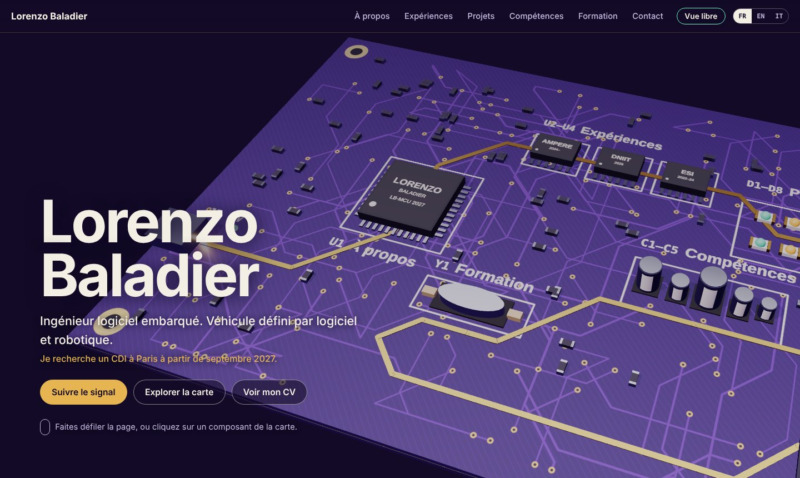
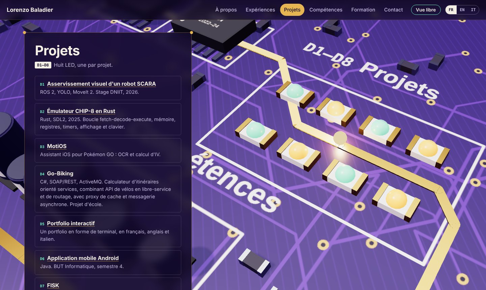
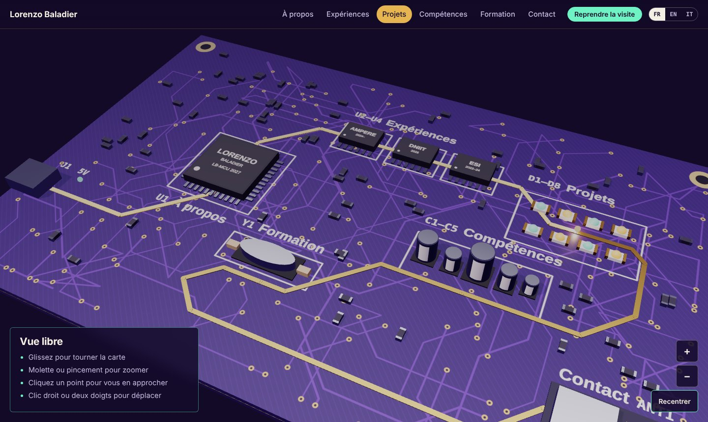

# portfolio-2

Mon portfolio, sous la forme d'un circuit imprimé en 3D. Un signal part du connecteur d'alimentation et parcourt la piste dorée : chaque composant qu'il atteint ouvre une section.



Site en ligne : [lorenzo-baladier.fr](https://lorenzo-baladier.fr)

## Ce qu'on y trouve

| Composant | Repère | Section |
| --- | --- | --- |
| Connecteur USB-C | J1 | Accueil |
| Microcontrôleur | U1 | À propos |
| Trois puces | U2–U4 | Expériences |
| Huit LED | D1–D8 | Projets |
| Cinq condensateurs | C1–C5 | Compétences |
| Quartz | Y1 | Formation |
| Module antenne | ANT1 | Contact |

Deux façons de se déplacer :

- **La visite guidée.** On fait défiler la page : la caméra suit le signal d'un composant au suivant. Le menu et un clic sur un composant mènent directement à une section.
- **La vue libre.** On tourne autour de la carte, on zoome à la molette ou avec les boutons, et un clic rapproche la caméra du point visé. Cliquer un composant affiche sa fiche et un raccourci vers sa section.

| Visite guidée | Vue libre |
| --- | --- |
|  |  |

Le site est disponible en français, en anglais et en italien. Sans WebGL, le contenu reste entièrement lisible ; avec l'option système « réduire les animations », la caméra se déplace sans transition.

## Lancer le projet

Il faut Node.js 20 ou plus récent.

```bash
npm install
npm run dev       # serveur local avec rechargement à chaud
npm run build     # site statique dans dist/
npm run preview   # sert dist/ pour vérifier le build
```

## Organisation du code

```
index.html              structure de la page
src/
  main.js               point d'entrée : relie le contenu, l'interface et la scène
  i18n.js               langue courante
  content/              tout le contenu du portfolio
    index.js            liens, compétences, ordre des sections
    fr.js  en.js  it.js textes par langue
  ui/
    sections.js         rendu HTML des sections
    tour.js             défilement -> position dans la visite
    freeDock.js         interface de la vue libre
  scene/                la carte en 3D (three.js)
    index.js            assemblage, clics, boucle de rendu
    layout.js           dimensions, positions des composants, tracé de la piste
    board.js            circuit nu et sérigraphie (texture dessinée au canvas)
    trace.js            piste dorée et signal
    components.js       puces, LED, condensateurs, quartz, antenne
    tourCamera.js       cadrages de la visite guidée
    freeView.js         caméra de la vue libre
    environment.js      éclairage et reflets
    materials.js        matériaux partagés
  styles/               une feuille par rôle (jetons, base, mise en page, contenu, vue libre)
```

Tout est modélisé dans le code : il n'y a ni fichier 3D ni image à charger.

## Mettre le contenu à jour

- **Un texte** : `src/content/fr.js`, puis la même clé dans `en.js` et `it.js`.
- **Un lien, une compétence** : `src/content/index.js`.
- **Un projet** : une entrée dans `projects` (les trois langues) et son lien dans `PROJECT_LINKS`. La carte compte huit LED ; pour en changer le nombre, voir la boucle `D1-D8` de `src/scene/components.js`.
- **La disposition de la carte** : `src/scene/layout.js` (positions, tracé de la piste, cadrages de caméra).

## Déploiement

Le workflow `.github/workflows/deploy.yml` construit le site et le publie sur GitHub Pages à chaque push sur `main`. Pour l'activer : *Settings → Pages → Source : GitHub Actions*.

Le build utilise des chemins relatifs : le dossier `dist/` peut aussi être déposé tel quel sur n'importe quel hébergement statique.

## Technique

[three.js](https://threejs.org) pour la 3D, [Vite](https://vite.dev) pour le build, et rien d'autre : HTML, CSS et JavaScript sans framework.
